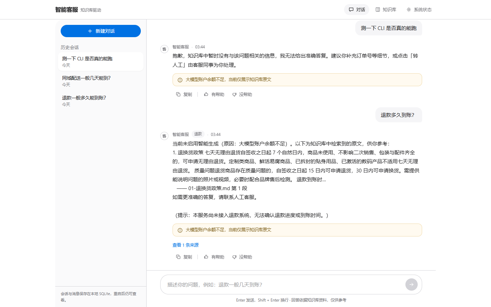
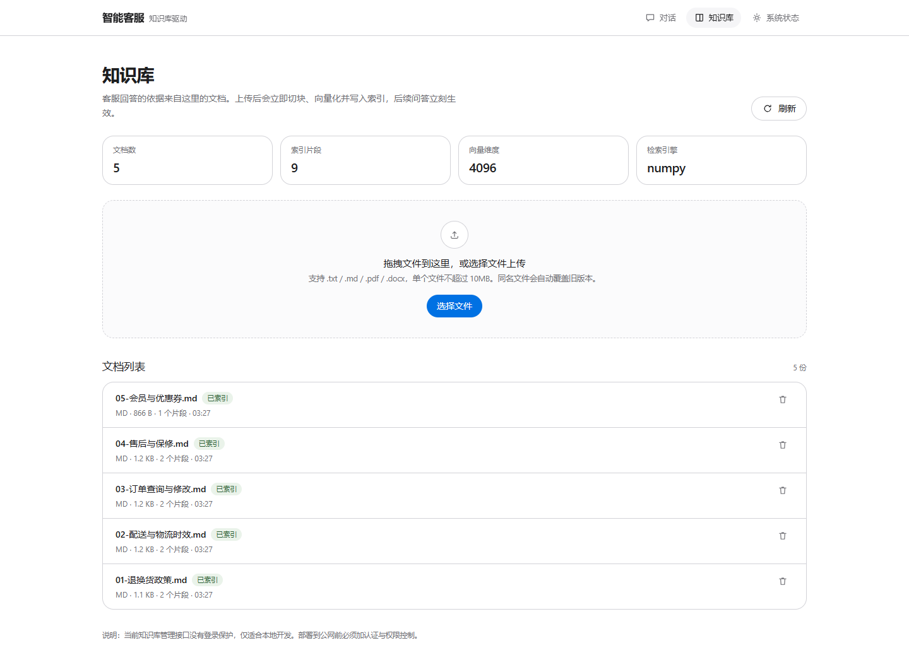
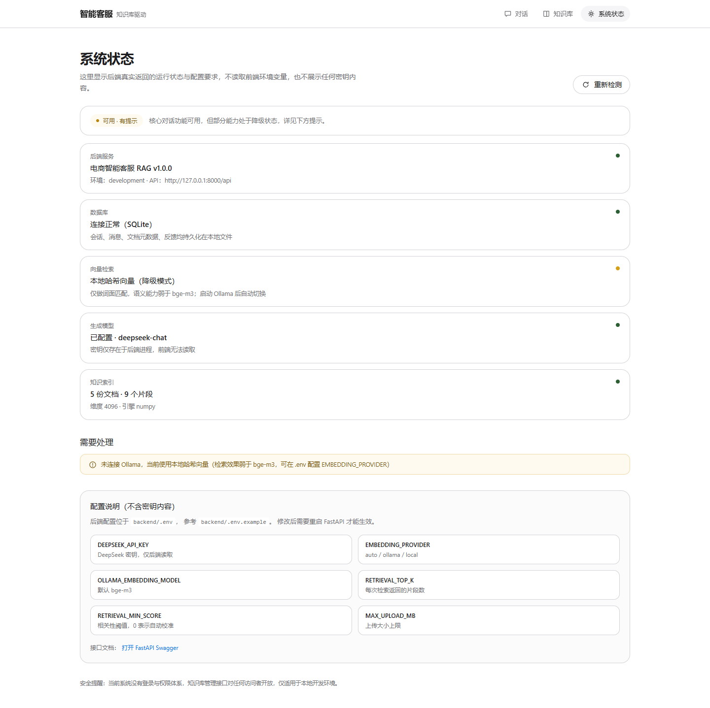

# 电商智能客服 RAG 全栈系统

一个可以真正跑起来的前后端分离电商客服系统：**意图识别 → 知识库检索 → DeepSeek 生成 → 会话持久化**，
前端采用苹果官网式的简约设计，后端是独立的 FastAPI 服务。

> 本项目从空目录开始搭建。所有“已验证”的结论都对应真实执行过的命令，
> 未验证的部分在 [已知问题](#已知问题与后续优化) 中逐条标注，不做夸大。



## 目录

- [功能](#功能)
- [技术栈](#技术栈)
- [快速开始](#快速开始)
- [页面说明](#页面说明)
- [API 一览](#api-一览)
- [测试](#测试)
- [配置说明](#配置说明)
- [目录结构](#目录结构)
- [安全说明](#安全说明)
- [已知问题与后续优化](#已知问题与后续优化)
- [学习路径](#学习路径)

## 功能

**聊天工作台**
- 会话列表、新建、切换、删除（数据来自数据库，刷新与重启后仍在）
- 用户/客服消息视觉区分、加载状态、空状态、错误态与重试
- 回答来源展示（文件名 + 片段序号 + 相关度 + 原文摘要）
- 一键复制回答、有帮助/没帮助反馈（落库）
- 移动端侧栏抽屉

**客服业务**
- 五类意图：查订单 / 退款 / 物流 / 售后 / 其他
- 规则优先 + 大模型兜底 + **白名单校验**（非法输出不会被写进数据库）
- 未接入真实订单/物流/退款系统时，明确提示而不是编造状态

**RAG 知识库**
- 支持 `.txt` / `.md` / `.pdf` / `.docx` 上传，自动清洗、分块、向量化、建索引
- 相关性阈值 + 词面覆盖度门槛 + 相邻片段去重
- 文档删除/覆盖时精准清理自己的向量，不影响其他文档
- 无相关资料时明确回答“无法确认”，引导转人工

**系统能力**
- FastAPI + Pydantic 校验、统一错误格式、CORS 白名单、请求大小限制
- SQLite 持久化（会话 / 消息 / 文档元数据 / 反馈），预留用户字段
- 80 条自动化测试，外部模型全部用可控替身
- 模型不可用（超时 / 余额不足 / 未配密钥）时降级为“仅展示资料原文”并明确标注

## 技术栈

| 层 | 选型 |
| --- | --- |
| 前端 | Next.js 15（App Router）、React 19、TypeScript、Tailwind CSS 3 |
| 后端 | Python 3.13、FastAPI、Pydantic v2、SQLAlchemy 2、Uvicorn |
| 数据库 | SQLite（`backend/data/app.db`） |
| 向量检索 | numpy 精确检索（装了 `faiss` 自动加速）；索引存 `backend/data/index/` |
| Embedding | Ollama `bge-m3`（优先）；不可用时降级为本地哈希向量 |
| 生成模型 | DeepSeek `deepseek-chat`（OpenAI 兼容协议） |
| 测试 | pytest + FastAPI TestClient |

## 快速开始

### 前置要求

- Python 3.11+（本项目在 3.13.14 上验证）
- Node.js 18+（本项目在 22.22.2 上验证）
- 可选：Ollama（语义检索效果更好）、DeepSeek API Key（启用智能生成）

### 1. 启动后端

```bash
cd backend

# 创建虚拟环境（Windows）
python -m venv .venv
.venv\Scripts\activate

# 安装依赖（国内网络慢可加 -i https://pypi.tuna.tsinghua.edu.cn/simple）
pip install -r requirements.txt

# 配置环境变量
copy .env.example .env
# 用编辑器打开 .env，填入 DEEPSEEK_API_KEY

# 启动
uvicorn app.main:app --reload --port 8000
```

验证：<http://127.0.0.1:8000/api/health> 应返回 JSON。首次启动会自动把
`knowledge_base/` 里的 5 份示例文档导入知识库。

> macOS / Linux 把 `.venv\Scripts\activate` 换成 `source .venv/bin/activate`，
> `copy` 换成 `cp`。

### 2. 启动前端

```bash
cd frontend
npm install
copy .env.example .env.local     # 默认指向 http://127.0.0.1:8000/api
npm run dev
```

打开 <http://localhost:3000>（会自动跳到 `/chat`）。

### 3. 按需启用更强能力

**语义检索（推荐）**：安装 [Ollama](https://ollama.com) 后

```bash
ollama pull bge-m3
ollama serve
```

后端下次启动会自动探测到 Ollama 并切换（`/api/health` 里 `embedding.provider` 变成 `ollama`）。

> 切换 embedding 模型后，**旧索引的向量维度不同**，需要重建：在 `/knowledge` 页面点击删除重传，
> 或调用 `POST /api/knowledge/reindex`。

**智能生成**：在 `backend/.env` 填 `DEEPSEEK_API_KEY`，重启后端。
未配置时系统仍可运行，但回答只是“检索到的原文”，`/api/health` 会给出警告。

### 4. 一键 Docker（未在本机验证）

```bash
# 需要 Docker Desktop
set DEEPSEEK_API_KEY=sk-xxxx
docker compose up --build
```

> 配置文件已提供（`backend/Dockerfile`、`frontend/Dockerfile`、`docker-compose.yml`），
> 但本机未执行 `docker build`，**构建结果未经验证**。本地启动方式以上面两步为准。

## 页面说明

| 路径 | 内容 |
| --- | --- |
| `/chat` | 会话列表、消息流、来源展开、复制、反馈、输入框、错误重试 |
| `/knowledge` | 拖拽/选择上传、文档列表与状态、片段数、删除、索引统计 |
| `/settings` | 后端真实状态（数据库/向量/模型/索引）、待处理提示、配置项说明 |




## API 一览

| 方法 | 路径 | 说明 |
| --- | --- | --- |
| GET | `/api/health` | 健康状态与降级原因 |
| POST | `/api/chat` | 提问，返回回答 + 意图 + 来源 |
| GET | `/api/sessions` | 会话列表 |
| POST | `/api/sessions` | 新建会话 |
| GET | `/api/sessions/{id}/messages` | 会话消息 |
| DELETE | `/api/sessions/{id}` | 删除会话（级联消息） |
| GET | `/api/knowledge` | 文档列表 + 索引统计 |
| POST | `/api/knowledge/upload` | 上传文档并索引 |
| DELETE | `/api/knowledge/{document_id}` | 删除文档与向量 |
| POST | `/api/knowledge/reindex` | 全量重建索引 |
| POST | `/api/feedback` | 有帮助 / 没帮助 |

请求响应结构、状态码约定、curl 示例见 [docs/API.md](docs/API.md)。
交互式文档：<http://127.0.0.1:8000/docs>。

## 测试

```bash
cd backend
.venv\Scripts\python.exe -m pytest
```

最近一次实际执行：**80 passed in 54.26s**。

详细用例清单与手工端到端验收步骤见 [docs/TESTING.md](docs/TESTING.md)。

前端类型检查：

```bash
cd frontend
npx tsc --noEmit
```

## 配置说明

后端配置在 `backend/.env`（模板 `backend/.env.example`），改完需重启。

| 变量 | 默认 | 说明 |
| --- | --- | --- |
| `DEEPSEEK_API_KEY` | 空 | 为空时进入“仅检索降级模式” |
| `EMBEDDING_PROVIDER` | `auto` | `auto` / `ollama` / `local` |
| `OLLAMA_EMBEDDING_MODEL` | `bge-m3` | 语义 embedding 模型 |
| `CHUNK_SIZE` / `CHUNK_OVERLAP` | 320 / 60 | 分块长度与重叠 |
| `RETRIEVAL_TOP_K` | 4 | 每次检索片段数 |
| `RETRIEVAL_MIN_SCORE` | 0 | 0 表示按 embedding 类型自动校准 |
| `MAX_UPLOAD_MB` | 10 | 上传大小上限 |
| `MAX_MESSAGE_CHARS` | 2000 | 单条消息长度上限 |
| `HISTORY_WINDOW` | 8 | 送入模型的历史消息条数 |

前端只有 `NEXT_PUBLIC_API_BASE_URL`，**不要**在这里放任何密钥（`NEXT_PUBLIC_` 变量会被打包进浏览器）。

## 目录结构

```
电商系统/
├── backend/
│   ├── app/
│   │   ├── main.py              # 应用装配：路由、CORS、异常处理、启动初始化
│   │   ├── config.py            # 集中配置（唯一读取环境变量的地方）
│   │   ├── api/routes/          # health / chat / sessions / knowledge / feedback
│   │   ├── services/            # chat / session / knowledge 业务编排
│   │   ├── rag/                 # chunker / embeddings / vector_store / retriever / prompt / loaders
│   │   ├── llm/                 # 模型客户端抽象 + DeepSeek 实现
│   │   ├── customer_service/    # 意图识别与校验
│   │   ├── db/                  # ORM 模型与连接
│   │   └── schemas/             # Pydantic 请求/响应模型
│   ├── tests/                   # 80 条自动化测试
│   ├── scripts/cli_chat.py      # 可选命令行入口（与网页共用业务逻辑）
│   ├── data/                    # SQLite、上传文件、向量索引（不入库）
│   └── requirements.txt
├── frontend/
│   ├── app/                     # /chat /knowledge /settings
│   ├── components/              # NavBar、图标、聊天子组件
│   └── lib/                     # api 客户端、类型、格式化
├── knowledge_base/              # 示例知识库文档（首次启动自动导入）
├── docs/                        # 架构、API、测试、学习指南、截图
└── docker-compose.yml
```

架构细节见 [docs/ARCHITECTURE.md](docs/ARCHITECTURE.md)。

## 安全说明

已做：

- 密钥只从后端环境变量读取，源码、前端、文档中均无真实密钥（有测试扫描校验）
- `.env` 与运行时数据已被 `.gitignore` 排除
- 上传文件校验扩展名、大小、空文件、二进制伪装；存储名用 UUID，防路径穿越
- 数据库访问全部走 SQLAlchemy ORM（参数化），不拼 SQL
- 用户输入长度限制；上传文档只当数据，不进入指令区
- 未处理异常返回统一 500，不泄露内部错误细节；日志不记录完整对话

**未做且必须注意**：

- **没有登录与权限体系**。知识库管理接口对任何能访问的人开放，仅适合本地开发。
  部署到公网前必须加认证（`sessions.user_id` 已预留字段）。
- 未做接口限流（429 已预留语义，但未实现）。
- 管理接口当前的“安全”依赖“只在本机监听”，不是真正的访问控制。

## 已知问题与后续优化

### 已实现且通过测试

- 健康检查、聊天、会话 CRUD、知识库上传/删除/重建、反馈
- 意图识别 + 白名单校验
- RAG 全链路（清洗/分块/向量化/检索/阈值/来源）
- SQLite 持久化、上下文隔离、级联删除
- 降级策略（未配密钥 / 超时 / 503 / 402）
- 80 条自动化测试；前端 `tsc --noEmit` 通过

### 已实现但尚未验证

- **DeepSeek 真实生成**：调用到达了 API，但账户返回 `HTTP 402 Payment Required`（余额不足），
  因此只验证到“正确识别 402 → 降级 + 提示”。充值后同一条链路即可产出模型回答。
- **Ollama + bge-m3**：本机未启动 Ollama，全部验证走的是本地哈希向量。
  语义检索效果需要在启动 Ollama 后重新评估阈值。
- **Docker 构建**：配置已写，未执行构建。

### 仅部分完成

- 检索质量：本地哈希向量只是词面匹配，同义词（“东西坏了” vs “质量问题”）检索不到。
  加 Ollama 后应重新校准 `RETRIEVAL_MIN_SCORE`。
- 前端交互的浏览器自动化：只做了渲染截图与接口级验证，点击流程靠手工清单（见 TESTING.md）。

### 尚未实现

- 用户登录、多租户数据隔离、管理接口鉴权
- 真实订单/物流/退款系统对接（当前是明确的“未接入”提示，不伪造数据）
- 流式输出（SSE）、回答重新生成、引用高亮到原文
- 接口限流、审计日志、多轮澄清式追问
- 单元测试覆盖前端组件（当前只有类型检查）

### 需要第三方授权才能实现

- 真实订单查询、物流轨迹、退款进度：需要电商平台/ERP/快递接口的账号与密钥
- 生产级语义检索：需要可用的 embedding 服务（Ollama 本地或云端 API）

## 学习路径

第一次接触这个项目，建议按这个顺序读：

1. [docs/LEARNING_GUIDE.md](docs/LEARNING_GUIDE.md) —— 分块、embedding、Top-K、Recall@K 等概念
2. `backend/app/services/chat_service.py` —— 一次问答的完整链路
3. `backend/app/rag/` —— 检索细节
4. `frontend/app/chat/page.tsx` —— 前端状态管理
5. [docs/ARCHITECTURE.md](docs/ARCHITECTURE.md) —— 分层与数据流

## 常见问题排查

| 现象 | 原因与处理 |
| --- | --- |
| 前端提示“无法连接后端服务” | 后端没启动，或端口不是 8000；检查 `NEXT_PUBLIC_API_BASE_URL` 与 `CORS_ORIGINS` |
| 回答总是“知识库没有相关信息” | 知识库为空，或问题与文档用词差异大（本地哈希向量）；先上传相关文档 |
| 所有回答都带“未启用智能生成” | 没配 `DEEPSEEK_API_KEY`，或余额不足（看后端日志是否有 402） |
| `/api/health` 显示 `embedding: local-hashing` | 没启动 Ollama，属正常降级；想用语义检索请 `ollama serve` |
| 上传后问不到新内容 | 看 `/knowledge` 中文档状态是否 `indexed`；失败会有原因 |
| 换 embedding 模型后报维度不一致 | 调 `POST /api/knowledge/reindex` 重建索引 |
| 500 错误 | 看后端终端堆栈；接口只返回统一提示，不暴露细节 |
