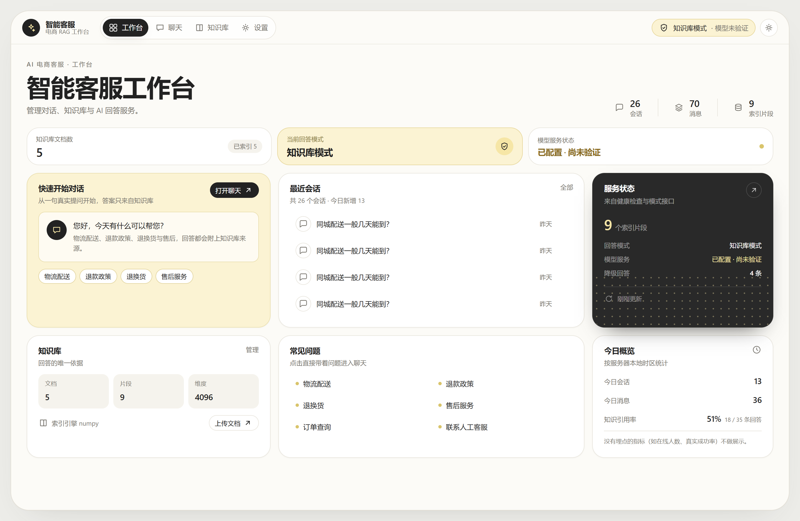
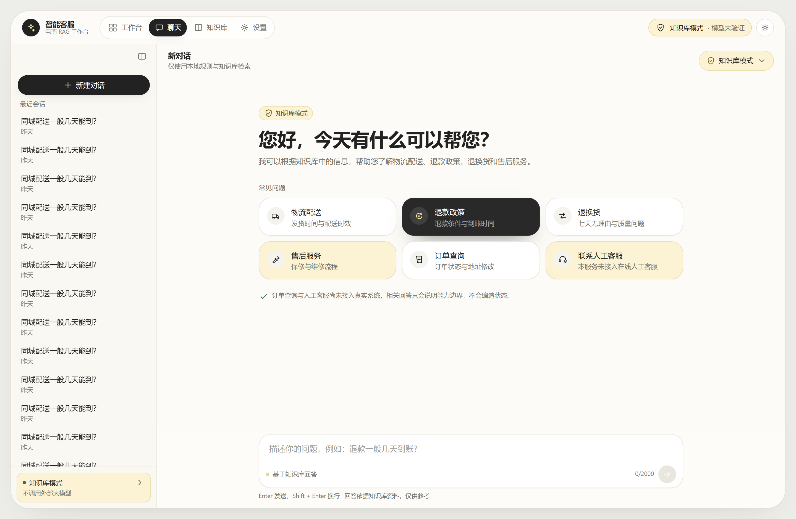
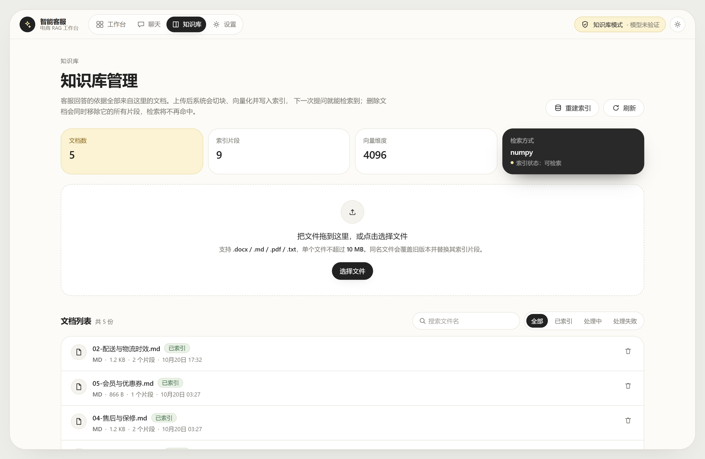
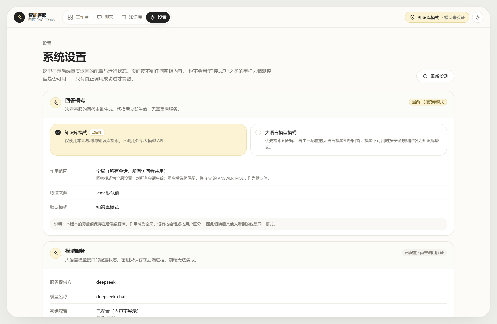

# 电商智能客服 RAG 全栈系统

一个可以真正跑起来的前后端分离电商客服系统：**意图识别 → 知识库检索 → DeepSeek 生成 → 会话持久化**。
前端是"智能客服工作台"式的仪表盘界面（灰底 + 暖白容器 + 奶油黄强调 + 深色卡片），后端是独立的 FastAPI 服务。

> 本项目从空目录开始搭建。所有“已验证”的结论都对应真实执行过的命令，
> 未验证的部分在 [已知问题](#已知问题与后续优化) 中逐条标注，不做夸大。



## 目录

- [功能](#功能)
- [技术栈](#技术栈)
- [快速开始](#快速开始)
- [页面说明](#页面说明)
- [界面设计说明](#界面设计说明)
- [API 一览](#api-一览)
- [测试](#测试)
- [配置说明](#配置说明)
- [目录结构](#目录结构)
- [安全说明](#安全说明)
- [已知问题与后续优化](#已知问题与后续优化)
- [学习路径](#学习路径)

## 功能

**工作台仪表盘（`/`）**
- 三块状态卡：知识库文档数（含已索引数）、当前回答模式、模型服务状态
- 六个功能模块：快速开始对话、最近会话、服务状态（深色卡）、知识库概览、常见问题、今日概览
- 每个数字都来自 `GET /api/stats` 的真实聚合；读不到就显示“—”，**不写死、不编造成功率**
- 每张卡都通向真实路由：`/chat`、`/chat?session=<id>`、`/chat?q=<真实问题>`、`/knowledge`、`/settings`

**聊天工作台（三层布局）**
- 左侧栏：新建对话 + 最近会话 + 当前模式（可折叠；全站导航在顶栏，不重复放一遍）
- 中央：标题栏（会话名 + 回答模式下拉）、独立滚动的消息区、底部固定输入区
- 首屏欢迎区：标题 + 说明 + 6 张快捷卡片（物流配送 / 退款政策 / 退换货 / 售后服务 / 订单查询 / 联系人工客服），
  卡片带图标、标题、说明，点击**真的**发出一次 `POST /api/chat`
- 消息气泡：用户靠右深色、客服靠左白底；回答走自研 Markdown 渲染（不显示原始符号、不用 `dangerouslySetInnerHTML`）
- 知识库回答按“来源 → 分节引用”排版：小标题加粗、条目还原成圆点，长文档不会被压成一段难以阅读的正文
- 回答类型标签区分：知识库回答 / 大语言模型回答 / 未找到可靠信息 / 已降级 / 服务范围说明 / 需要澄清
- 来源区紧凑可折叠：文档名 + 片段序号 + **真实相关度分数**；没有命中就不显示来源
- 输入区：Enter 发送、Shift+Enter 换行、空输入禁用、发送中 loading 且防重复（同步锁 + disabled 双闸）、失败可重试、长文本自动扩展
- 移动端：侧栏抽屉、无横向溢出

**对话引导（本地规则，不走检索）**
- 纯问候 → 欢迎语；`你是谁` → 服务介绍；`谢谢` → 礼貌回应；`再见` → 告别语
- 无关问题 → 说明服务范围；看不懂 → 请换个说法。两者都附快捷问题
- 判据是“剥掉客套词后还剩什么”，所以 `你好，我想退款` **仍然退回到退款检索**
- 回复用 `reply_type` 区分来源，只有真正引用原文时才标“知识库原文”

**客服业务**
- 五类意图：查订单 / 退款 / 物流 / 售后 / 其他
- 规则优先 + 大模型兜底 + **白名单校验**（非法输出不会被写进数据库）
- 未接入真实订单/物流/退款系统时，明确提示而不是编造状态

**RAG 知识库**
- 支持 `.txt` / `.md` / `.pdf` / `.docx` 上传，自动清洗、分块、向量化、建索引
- 相关性阈值 + 词面覆盖度门槛 + 相邻片段去重
- 文档删除/覆盖时精准清理自己的向量，不影响其他文档
- 无相关资料时明确回答“无法确认”，引导转人工

**系统能力**
- FastAPI + Pydantic 校验、统一错误格式、CORS 白名单、请求大小限制
- SQLite 持久化（会话 / 消息 / 文档元数据 / 反馈），预留用户字段
- 193 条自动化测试，外部模型全部用可控替身（含真实 HTTP 打桩的 Ollama 协议测试）
- 模型不可用（超时 / 余额不足 / 未配密钥）时降级为“仅展示资料原文”并明确标注

## 技术栈

| 层 | 选型 |
| --- | --- |
| 前端 | Next.js 15（App Router）、React 19、TypeScript、Tailwind CSS 3 |
| 后端 | Python 3.13、FastAPI、Pydantic v2、SQLAlchemy 2、Uvicorn |
| 数据库 | SQLite（`backend/data/app.db`） |
| 向量检索 | numpy 精确检索（装了 `faiss` 自动加速）；索引存 `backend/data/index/` |
| Embedding | Ollama `bge-m3`（优先）；不可用时降级为本地哈希向量 + BM25 词法检索 |
| 回答模式 | 默认**知识库模式**（零外联）；`.env` 的 `ANSWER_MODE` 是默认值，页面切换会写库覆盖（全局生效，重启保留） |
| 生成模型 | DeepSeek `deepseek-chat`（OpenAI 兼容协议，可选） |
| 测试 | pytest + FastAPI TestClient |

## 快速开始

### 前置要求

- Python 3.11+（本项目在 3.13.14 上验证）
- Node.js 18+（本项目在 22.22.2 上验证）
- 可选但**强烈推荐**：Ollama（语义检索，不装则自动降级为词面检索）；DeepSeek API Key（启用智能生成）

### 1. 启动后端

```bash
cd backend

# 创建虚拟环境（Windows）
python -m venv .venv
.venv\Scripts\activate

# 安装依赖（国内网络慢可加 -i https://pypi.tuna.tsinghua.edu.cn/simple）
pip install -r requirements.txt

# 配置环境变量
copy .env.example .env
# 用编辑器打开 .env，填入 DEEPSEEK_API_KEY

# 启动
uvicorn app.main:app --reload --port 8000
```

验证：<http://127.0.0.1:8000/api/health> 应返回 JSON。首次启动会自动把
`knowledge_base/` 里的 5 份示例文档导入知识库。

> macOS / Linux 把 `.venv\Scripts\activate` 换成 `source .venv/bin/activate`，
> `copy` 换成 `cp`。

### 2. 启动前端

```bash
cd frontend
npm install
copy .env.example .env.local     # 默认指向 http://127.0.0.1:8000/api
npm run dev
```

打开 <http://localhost:3000>（会自动跳到 `/chat`）。

### 3. 按需启用更强能力

**语义检索（推荐）**：不装 Ollama 也能用（自动降级为本地哈希向量 + BM25），
但哈希向量只是**词面近似**，"东西坏了" 与 "质量问题" 互相检索不到。装上之后效果有质变。

```bash
# 1. 安装 Ollama（Windows）
winget install --id Ollama.Ollama -e
#   或到 https://ollama.com/download 下载 OllamaSetup.exe 直接装

# 2. 确认服务起来了（默认监听 11434）
ollama --version
curl http://127.0.0.1:11434/api/tags

# 3. 拉语义模型（bge-m3 约 1.2 GB，输出 1024 维）
ollama pull bge-m3

# 4. 确认模型真的能用，并确认真实维度
curl http://127.0.0.1:11434/api/embed -d '{"model":"bge-m3","input":"退货政策"}'
#   返回 JSON 里 embedding 数组的长度就是真实维度（bge-m3 = 1024）
```

> macOS / Linux 用 `brew install ollama` 或官方脚本，其余命令相同。
>
> **装完记得新开一个终端**：安装程序写的 PATH 对已经打开的 shell 不生效，
> 否则会看到 `ollama: command not found` 而误以为没装上。
> 想立刻验证又不想重开终端，可以直接用全路径
> `%LOCALAPPDATA%\Programs\Ollama\ollama.exe list`。

然后把 `backend/.env` 的 provider 固定下来，避免 auto 探测的歧义：

```bash
# backend/.env
EMBEDDING_PROVIDER=ollama
OLLAMA_EMBEDDING_MODEL=bge-m3
```

**必须重建索引**——哈希向量是 4096 维、bge-m3 是 1024 维，两者不能混用：

```bash
curl -X POST http://127.0.0.1:8000/api/knowledge/reindex
```

重建走**暂存区**：先在临时目录建好新索引，全部成功才原子替换线上索引；
中途失败线上旧索引与文档状态都原封不动（不会出现"重建一次知识库就没了"）。

`/api/health` 里正常的状态应该长这样：

```json
"embedding": { "provider": "ollama", "model": "bge-m3", "dim": 1024,
               "is_semantic": true, "is_fallback": false,
               "service_reachable": true, "model_installed": true },
"retrieval": { "index_signature": "ollama:bge-m3", "needs_reindex": false }
```

`needs_reindex: true` 说明索引还是旧模型建的，调一次 reindex 即可。
切换后检索阈值会自动按 provider 校准（`ollama` → 0.55，`local-hashing` → 0.15），
因为 bge-m3 对无关中文短句的余弦也有 0.3~0.5，沿用低阈值会把无关问题全放进来。

**智能生成（默认关闭）**：默认 `ANSWER_MODE=knowledge_only`，只用本地规则 + 知识库回答，
**不发起任何外部模型请求**——即使 `.env` 里填了 Key 也一样。

要启用模型生成，必须显式改两处：

```bash
# backend/.env
ANSWER_MODE=llm
DEEPSEEK_API_KEY=sk-xxxx
```

重启后 `/api/health` 里 `llm.enabled` 变成 `true`、`llm.will_be_called` 变成 `true`，
前端模式条消失。模型不可用时（超时/402/余额不足）会自动降级为陈列知识库原文，
并在回答上方显示黄色提示条，`degraded` 字段标明具体原因。

### 4. 一键 Docker（未在本机验证）

```bash
# 需要 Docker Desktop
set DEEPSEEK_API_KEY=sk-xxxx
docker compose up --build
```

> 配置文件已提供（`backend/Dockerfile`、`frontend/Dockerfile`、`docker-compose.yml`），
> 但本机未执行 `docker build`，**构建结果未经验证**。本地启动方式以上面两步为准。

## 页面说明

| 路径 | 内容 |
| --- | --- |
| `/` | 「智能客服工作台」仪表盘：三块状态卡（文档数 / 回答模式 / 模型状态）+ 六个模块（快速开始、最近会话、服务状态、知识库、常见问题、今日概览）。所有数字来自 `GET /api/stats` |
| `/chat` | 三层布局：左侧栏（新建对话 / 最近会话 / 运行模式，可折叠）＋ 中央标题栏（会话名 + 回答模式下拉）＋ 消息区与底部固定输入区；欢迎区含标题、说明与 6 张快捷卡片 |
| `/knowledge` | 「知识库管理」：真实统计（文档数 / 片段数 / 维度 / 检索方式与索引状态）、拖拽上传（显示后端返回的支持类型与大小上限、逐文件进度与失败原因）、重建索引、文件名搜索 + 状态筛选、文档列表、删除前确认弹窗 |
| `/settings` | 五个卡片区：回答模式（可切换、显示作用范围与来源）、模型服务（四态状态 + 最近一次失败原因，不显示密钥）、检索设置（`top_k` / 阈值 / 覆盖度 / 切块参数 / embedding）、系统状态（服务 / 数据库 / 索引 / 警告）、关于项目 |

### 回答模式切换

顶栏「回答模式」下拉有两个选项，各带一句说明；选中项同时有**图标 + “当前使用”文字**（不只靠颜色）。
知识库模式用暖白/奶油黄，大语言模型模式用深色高对比，两者在灰度屏上也能分辨。
切换走 `PUT /api/settings/answer-mode`，由后端校验并落库，前端只认后端返回的结果，
失败会回读真实状态——不会出现“界面显示已切换、后端其实没切”。

| 模式 | 行为 |
| --- | --- |
| 知识库模式（默认） | 意图识别走本地规则，回答为知识库原文摘录；即使 `.env` 里有 Key 也不会发出任何外部请求 |
| 大语言模型模式 | 先检索知识库，再由模型组织语言；模型不可用时按既有策略降级为原文，并明确标注 |

模型是否可用只有四种状态（`not_configured` / `unverified` / `ok` / `error`），
来自**最近一次真实调用**，不做启动时的试探性请求——既费钱，也证明不了下一次可用。





## 界面设计说明

设计语言参考现代 SaaS 工作台：**灰底 + 暖白主容器 + 白色卡片 + 奶油黄强调 + 深色卡片**，
不用渐变、不用发光、不用玻璃拟态。

| 语义名 | 值 | 用途 |
| --- | --- | --- |
| `shell` | `#EDEDE9` | 页面最外层灰底 |
| `paper` | `#FCFBF7` | 主容器（暖白） |
| `surface` | `#FFFFFF` | 卡片 |
| `cream` / `cream-soft` | `#F6E6A6` / `#FBF3D3` | 强调、选中态、知识库模式 |
| `dark` | `#292929` | 深色卡、大模型模式选中态 |
| `ink` / `muted` | `#222222` / `#77746D` | 主文字 / 次文字 |
| `hairline` | `#E9E6DE` | 细边框 |
| 圆角 | `frame 32px` / `card 22px` / `control 12px` / `pill 999px` | — |

所有这些都定义在 `frontend/tailwind.config.ts`，组件只用语义类名（`bg-paper`、`text-ink`…），
换肤只改一处值，不需要在几十个文件里替换字面量。

无障碍与动效约定：

- 选中态一律“底纹 + 图标 + 文字”三重标识，不只靠颜色（色觉障碍与灰度屏可用）
- `prefers-reduced-motion: reduce` 时关闭上升/淡入/骨架屏动画与 hover 位移
- 所有图标按钮都有 `aria-label`；模式菜单支持 Enter/Space 展开、↑↓ 移动、Esc 关闭并回到触发器
- 动效只用于反馈（hover 抬升 2px、按下回弹、菜单弹出、骨架屏），不做装饰性循环动画

## API 一览

| 方法 | 路径 | 说明 |
| --- | --- | --- |
| GET | `/api/health` | 健康状态与降级原因 |
| GET | `/api/stats` | 工作台统计（会话 / 消息 / 文档 / 片段 / 回答分布 / 知识引用率），全部为真实聚合 |
| GET | `/api/chat/welcome` | 首屏欢迎语 + 快捷问题（只读，不建会话） |
| POST | `/api/chat` | 提问，返回回答 + 回复类型 + 快捷问题 + 意图 + 来源 |
| GET | `/api/sessions` | 会话列表 |
| POST | `/api/sessions` | 新建会话 |
| GET | `/api/sessions/{id}/messages` | 会话消息 |
| DELETE | `/api/sessions/{id}` | 删除会话（级联消息） |
| GET | `/api/knowledge` | 文档列表 + 索引统计 |
| POST | `/api/knowledge/upload` | 上传文档并索引 |
| DELETE | `/api/knowledge/{document_id}` | 删除文档与向量 |
| POST | `/api/knowledge/reindex` | 全量重建索引 |
| POST | `/api/feedback` | 有帮助 / 没帮助 |

请求响应结构、状态码约定、curl 示例见 [docs/API.md](docs/API.md)。
交互式文档：<http://127.0.0.1:8000/docs>。

## 测试

```bash
cd backend
.venv\Scripts\python.exe -m pytest
```

最近一次实际执行：**193 passed / 0 failed**（新增 `tests/test_embeddings_provider.py` 7 条：
真实 HTTP 打桩验证"确实调用了 Ollama / 用服务返回的维度 / 服务通但模型没 pull 时正确判失败 /
Ollama 挂了知识库仍可用 / 重建失败旧索引零改动 / 4096→1024 换模型后无需再重建 / 维度不符在改动前抛错"）。

浏览器端另有 Playwright 脚本 `.workbuddy/verify_ui_v2.mjs`（交互回归），
在生产构建（`npm run build && npm run start`）上跑 **74 项断言全通过**：
模式菜单键盘操作、模式切换真实落到后端、快捷卡片真实提交、上传/删除/重建索引、
移动端无横向溢出等。详细用例清单与手工验收步骤见 [docs/TESTING.md](docs/TESTING.md)。

视觉改版的验收另有一份 `.workbuddy/shot_phase8.mjs`（**18 项断言全通过**），
它同时负责生成 `docs/screenshots/` 下的截图：
首页三块状态卡的真实数据、欢迎区与 6 张快捷卡片、点击后真的出回答、
模式菜单展开与 Esc 关闭、知识库搜索筛选、设置页五块卡片、移动端三页无横向溢出。

前端类型检查：

```bash
cd frontend
npx tsc --noEmit
```

## 配置说明

后端配置在 `backend/.env`（模板 `backend/.env.example`），改完需重启。

> 本仓库保留了 `backend/.env`（内含非敏感的默认值），`DEEPSEEK_API_KEY` **故意留空**，
> 需要时从系统环境变量注入，避免密钥被误提交。`.env` 已被 `.gitignore` 排除。

| 变量 | 默认 | 说明 |
| --- | --- | --- |
| `ANSWER_MODE` | `knowledge_only` | 回答来源模式：`knowledge_only`（纯知识库，零外联）/ `llm`（模型生成，需显式开启） |
| `RETRIEVAL_MODE` | `hybrid` | 检索通道：`hybrid`（向量 + BM25 融合）/ `vector` / `lexical` |
| `RETRIEVAL_MIN_COVERAGE` | 0.12 | 词法通道最低加权覆盖度；调高更保守，调低召回更多 |
| `DEEPSEEK_API_KEY` | 空 | **只在 `ANSWER_MODE=llm` 时才会被使用**；为空则走降级 |
| `EMBEDDING_PROVIDER` | `auto` | `auto`（探测失败自动降级）/ `ollama`（要求语义，失败也降级并告警）/ `local`（强制哈希） |
| `OLLAMA_EMBEDDING_MODEL` | `bge-m3` | 语义 embedding 模型 |
| `CHUNK_SIZE` / `CHUNK_OVERLAP` | 320 / 60 | 分块长度与重叠 |
| `RETRIEVAL_TOP_K` | 4 | 每次检索片段数 |
| `RETRIEVAL_MIN_SCORE` | 0 | 向量通道阈值，0 表示按 embedding 类型自动校准（`ollama`=0.55 / `local-hashing`=0.15）；填具体值则强制覆盖 |
| `MAX_UPLOAD_MB` | 10 | 上传大小上限 |
| `MAX_MESSAGE_CHARS` | 2000 | 单条消息长度上限 |
| `HISTORY_WINDOW` | 8 | 送入模型的历史消息条数 |

**最容易踩的坑**：环境里有 `DEEPSEEK_API_KEY` 不代表会被调用。
是否调用只看 `ANSWER_MODE`，这是两个独立的开关——`/api/health` 里
`llm.configured=true` 但 `llm.will_be_called=false` 就是这个状态。

前端只有 `NEXT_PUBLIC_API_BASE_URL`，**不要**在这里放任何密钥（`NEXT_PUBLIC_` 变量会被打包进浏览器）。

## 目录结构

```
电商系统/
├── backend/
│   ├── app/
│   │   ├── main.py              # 应用装配：路由、CORS、异常处理、启动初始化
│   │   ├── config.py            # 集中配置（唯一读取环境变量的地方）
│   │   ├── api/routes/          # health / chat / sessions / knowledge / feedback
│   │   ├── services/            # chat / session / knowledge 业务编排
│   │   ├── rag/                 # chunker / embeddings / vector_store / retriever / prompt / loaders
│   │   ├── llm/                 # 模型客户端抽象 + DeepSeek 实现
│   │   ├── customer_service/    # 意图识别与校验 / 对话引导规则（问候、致谢、快捷问题）
│   │   ├── db/                  # ORM 模型与连接
│   │   └── schemas/             # Pydantic 请求/响应模型
│   ├── tests/                   # 182 条自动化测试
│   ├── scripts/cli_chat.py      # 可选命令行入口（与网页共用业务逻辑）
│   ├── data/                    # SQLite、上传文件、向量索引（不入库）
│   └── requirements.txt
├── frontend/
│   ├── app/                     # /chat /knowledge /settings
│   ├── components/              # NavBar、图标、聊天子组件
│   └── lib/                     # api 客户端、类型、格式化
├── knowledge_base/              # 示例知识库文档（首次启动自动导入）
├── docs/                        # 架构、API、测试、学习指南、截图
└── docker-compose.yml
```

架构细节见 [docs/ARCHITECTURE.md](docs/ARCHITECTURE.md)。

## 安全说明

已做：

- 密钥只从后端环境变量读取，源码、前端、文档中均无真实密钥（有测试扫描校验）
- `.env` 与运行时数据已被 `.gitignore` 排除
- 上传文件校验扩展名、大小、空文件、二进制伪装；存储名用 UUID，防路径穿越
- 数据库访问全部走 SQLAlchemy ORM（参数化），不拼 SQL
- 用户输入长度限制；上传文档只当数据，不进入指令区
- 未处理异常返回统一 500，不泄露内部错误细节；日志不记录完整对话

**未做且必须注意**：

- **没有登录与权限体系**。知识库管理接口对任何能访问的人开放，仅适合本地开发。
  部署到公网前必须加认证（`sessions.user_id` 已预留字段）。
- 未做接口限流（429 已预留语义，但未实现）。
- 管理接口当前的“安全”依赖“只在本机监听”，不是真正的访问控制。

## 已知问题与后续优化

### 已实现且通过测试

- 健康检查、聊天、会话 CRUD、知识库上传/删除/重建、反馈
- 意图识别 + 白名单校验
- RAG 全链路（清洗/分块/向量化/检索/阈值/来源）
- SQLite 持久化、上下文隔离、级联删除
- 降级策略（未配密钥 / 超时 / 503 / 402）
- 回答模式的运行期切换（后端校验 + 落库 + 重启恢复 + 全链路生效）
- 193 条自动化测试；前端 `tsc --noEmit` 通过；生产构建通过；浏览器 74 项断言通过

### 已实现并已在本机验证

- **Ollama + bge-m3 语义检索**：已在本机安装 Ollama 0.40.6 并 pull `bge-m3:latest`（`ollama list` 显示 1.2 GB，1024 维）。
  `POST /api/knowledge/reindex` 重建 5 份文档 / 9 个片段耗时 6.5 秒，
  返回 `{"indexed":5,"failed":0,"dim":1024,"signature":"ollama:bge-m3"}`；
  `vectors.npy` 36992 字节 = 9 × 1024 × 4 + 128 字节头，独立核对维度无误。
  检索阈值按实测分布校准为 0.55（15 条真问题余弦 0.584~0.781，12 条无关 0.282~0.528），
  `scripts/eval_retrieval.py` 的误答从 5/8 降到 0/8。

### 已实现但尚未验证

- **DeepSeek 真实生成**：调用到达了 API，但账户返回 `HTTP 402 Payment Required`（余额不足），
  因此只验证到“正确识别 402 → 降级 + 提示”。充值后同一条链路即可产出模型回答。
- **Docker 构建**：配置已写，未执行构建。
- **`llm` 模式下的真实生成**：本机 `.env` 配了 Key，但状态是 `unverified`（没有成功调用记录），
  页面会如实这么显示；E2E 测试在切到 `llm` 后立刻切回，不消耗配额。

### 仅部分完成

- 检索质量：语义检索已上线，同义词问题基本解决；但**阈值校准的样本只有 5 篇文档 / 9 个片段**，
  属于"够用但不等于充分校准"。边界例：*"火星上的配送要几天"* 余弦 0.588，刚好越过 0.55，
  会返回真实的配送时效原文（内容非编造，但属于语义相似度的边界地带）。
  语料扩充后应重跑 `backend/scripts/eval_retrieval.py`（内含 `sweep_min_score`，
  会打印正/负样本的余弦分布并给出建议阈值）。
- 本地哈希向量的降级路径仍保留（`EMBEDDING_PROVIDER=local` 或 Ollama 挂掉时生效），
  那条路径只有词面匹配能力。
- 前端交互的浏览器自动化：已用 Playwright 跑通 74 项断言（含模式切换、上传/删除/重建索引、
  移动端抽屉），但脚本未纳入 `npm test`，不是 CI 门禁。
- 快捷问题的命中率绑定当前语料：6 条 `query` 是按现有 5 篇文档实测挑的，
  换语料后可能落到 `no_answer`（会诚实说没找到，不会编造），需重跑 `scripts/eval_retrieval.py` 复核。

### 尚未实现

- 用户登录、多租户数据隔离、管理接口鉴权
- 真实订单/物流/退款系统对接（当前是明确的“未接入”提示，不伪造数据）
- 流式输出（SSE）、引用高亮到原文（“重新回答”按钮已实现）
- 接口限流、审计日志、多轮澄清式追问
- 单元测试覆盖前端组件（当前只有类型检查）

### 需要第三方授权才能实现

- 真实订单查询、物流轨迹、退款进度：需要电商平台/ERP/快递接口的账号与密钥
- 生产级语义检索：需要可用的 embedding 服务（Ollama 本地或云端 API）

## 学习路径

第一次接触这个项目，建议按这个顺序读：

1. [docs/LEARNING_GUIDE.md](docs/LEARNING_GUIDE.md) —— 分块、embedding、Top-K、Recall@K 等概念
2. `backend/app/services/chat_service.py` —— 一次问答的完整链路
3. `backend/app/rag/` —— 检索细节
4. `frontend/app/chat/page.tsx` —— 前端状态管理
5. [docs/ARCHITECTURE.md](docs/ARCHITECTURE.md) —— 分层与数据流

## 常见问题排查

| 现象 | 原因与处理 |
| --- | --- |
| 前端提示“无法连接后端服务” | 后端没启动，或端口不是 8000；检查 `NEXT_PUBLIC_API_BASE_URL` 与 `CORS_ORIGINS` |
| 回答总是“知识库没有相关信息” | 知识库为空，或问题与文档用词差异大（本地哈希向量）；先上传相关文档 |
| 所有回答都带“未启用智能生成” | 没配 `DEEPSEEK_API_KEY`，或余额不足（看后端日志是否有 402） |
| `/api/health` 显示 `embedding.provider=local-hashing` | 没装/没启动 Ollama，属正常降级（知识库仍可用）。看 `embedding.fallback_reason` 的具体原因 |
| `fallback_reason` 说"连不上" | `curl http://127.0.0.1:11434/api/tags` 试一下；**如果返回 502 而不是拒绝连接，通常是本机 HTTP 代理拦了 127.0.0.1**，探活要先走裸 TCP |
| `fallback_reason` 说"模型未安装" | 服务通了但没 pull：`ollama pull bge-m3` |
| `service_reachable=true` 但 `active_provider` 还是降级实现 | 后端进程启动时没探测到，改完配置**重启后端**（`restart_required` 字段会提示） |
| 换 embedding 模型后报维度不一致 / `needs_reindex=true` | 调 `POST /api/knowledge/reindex` 重建索引（会先建暂存区，失败不动线上索引） |
| 上传后问不到新内容 | 看 `/knowledge` 中文档状态是否 `indexed`；失败会有原因 |
| 500 错误 | 看后端终端堆栈；接口只返回统一提示，不暴露细节 |
